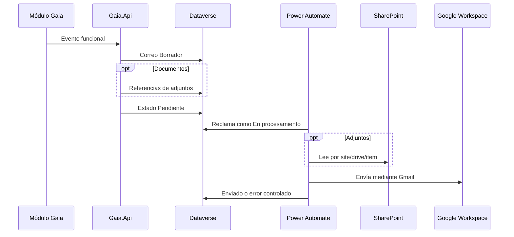

# Notificaciones institucionales por correo

> Estado: **base transversal y flujos activos; pruebas controladas sin adjuntos y de reintento aprobadas; validación desde Solicitudes y con adjuntos pendiente** · Verificado: **2026-10-14**
> Evidencia principal: `Gaia.BuildingBlocks.Notifications`, `DataverseEmailNotificationQueue`, `DataverseSolicitudesNotificationPublisher`, pruebas de cola y de casos de uso, y solución Dataverse `ConfiguracionCorreo` empaquetada desde fuente versionable.

## Propósito

Gaia genera notificaciones desde cualquier módulo sin acoplar sus casos de uso a Gmail, Outlook o Power Automate. La API registra una intención completa e idempotente en Dataverse; Power Automate procesa únicamente correos listos y usa la cuenta institucional de Google Workspace `notificaciones@gaiaamazonas.org`.

## Modelo Dataverse

La solución `ConfiguracionCorreo` contiene:

- `gaia_plantillacorreo`: plantillas versionadas y vigentes;
- `gaia_correosaliente`: outbox con destinatarios, contenido final e idempotencia;
- `gaia_adjuntocorreo`: referencias internas a documentos de SharePoint, nunca binarios;
- opciones globales para estado, prioridad, proveedor, modo de entrega y estado del adjunto.

La clave `gaia_idoperacion` evita duplicados. La API conserva asunto y HTML renderizados para que una modificación posterior de la plantilla no cambie evidencia histórica.

## Contrato de la API

`IEmailNotificationOutbox` es el puerto transversal. Recibe módulo, evento, origen, plantilla, destinatarios, variables y referencias opcionales de SharePoint. La implementación:

1. normaliza códigos y direcciones;
2. resuelve exactamente una plantilla activa y vigente;
3. codifica como HTML los valores insertados en el cuerpo;
4. crea el correo en `Borrador`;
5. registra todos los adjuntos;
6. cambia a `Pendiente` únicamente al completar las validaciones;
7. reutiliza `gaia_idoperacion` si el mismo comando se repite.

Los errores de preparación dejan evidencia controlada y no exponen respuestas de proveedor, tokens ni direcciones temporales.

## Integración inicial de Solicitudes

Eventos conectados:

| Evento | Plantilla | Destinatario |
|---|---|---|
| Radicación | `SOLICITUD_RADICADA` | solicitante con correo institucional activo |
| Asignación o reasignación general | `SOLICITUD_ASIGNADA` | responsable específico |
| Reasignación de etapa | `SOLICITUD_ETAPA_ASIGNADA` | responsable específico de la gestión |

Una bandeja de unidad sin responsable individual no genera correo masivo: todavía no existe una regla aprobada para decidir si se notifica a todos los integrantes, a una cuenta compartida o a un rol. La operación funcional no se revierte si el correo no puede encolarse; el error queda registrado para conciliación.

## Plantillas iniciales requeridas

Las tres plantillas deben crearse como versión `1`, módulo `SOLICITUDES`, perfil `GAIA_INSTITUCIONAL`, idioma `es-CO`, sin adjuntos obligatorios y activas. Variables disponibles:

- comunes: `numeroSolicitud`, `servicio`, `asunto`, `fechaLimite`;
- radicación: además `fechaRadicacion`;
- asignación: además `responsable`;
- etapa: además `responsable` y `etapa`.

En `DesarrolloTI`, las tres plantillas versión `1` fueron creadas el 13 de octubre de 2026 mediante el aprovisionador idempotente. Cada ambiente nuevo debe ejecutar su propia validación y aprovisionamiento; los registros de configuración no se presuponen transportados por la solución.

## Flujo principal de Power Automate

El flujo `Despachar correos institucionales` está incluido, publicado y activo en `ConfiguracionCorreo`. Usa referencias de conexión y la variable de entorno del remitente. Su implementación:

1. disparador Dataverse al agregar o modificar `gaia_correosaliente`, filtrado por cambios de `gaia_estadoenvio`;
2. continuar únicamente si el estado es `Pendiente` y `gaia_disponibledesde` no está en el futuro;
3. reclamar el registro como `En procesamiento` antes de descargar archivos;
4. obtiene adjuntos activos relacionados y lee SharePoint mediante `DriveId` y `DriveItemId`;
5. enviar mediante Gmail desde `notificaciones@gaiaamazonas.org`, asociado al perfil lógico `GAIA_INSTITUCIONAL`;
6. actualizar `Enviado`, fecha e identificador devuelto por Gmail;
7. aplica reintentos exponenciales del conector Gmail y registra el fallo agotado como `Error definitivo`;
8. procesa secuencialmente los adjuntos y evita procesar dos veces una misma fila mediante el estado del outbox;
9. protege entradas y salidas que contienen cuerpo, destinatarios o contenido de archivos en el historial de ejecución;
10. marca los adjuntos como `Incorporado` después de que el correo ya quedó registrado como `Enviado`.

La referencia lógica de archivos es `gaia_SharePointCorreoInstitucional`. La conexión concreta se asigna en cada ambiente durante la importación.

El flujo `Reintento controlado de correos` se ejecuta cada 15 minutos. Devuelve a `Pendiente` los errores reintentables cuya fecha ya venció y cuyo contador todavía es menor que `gaia_maximointentos`; cuando se alcanza el máximo registra `Error definitivo`.

Ambos flujos están activos en `DesarrolloTI`. El 14 de octubre de 2026 se aprobaron un envío controlado sin adjuntos y un recorrido de reintento que pasó de `Error reintentable` a `Pendiente`, incrementó el contador y terminó en `Enviado`. Permanecen pendientes la validación originada desde una solicitud real y las pruebas con uno y varios documentos reales de SharePoint.

La solución puede reconstruirse desde `solutions/ConfiguracionCorreo/src` en el repositorio de Power Apps. El paquete `artifacts/ConfiguracionCorreo.zip` fue empaquetado, desempaquetado nuevamente y validado con `scripts/Test-GaiaConfiguracionCorreoSolution.ps1`.

## Seguridad y operación

- La conexión de Dataverse y la conexión Gmail pertenecen a identidades institucionales administradas.
- La autenticación OAuth de `notificaciones@gaiaamazonas.org` se conserva exclusivamente en la referencia de conexión de Power Automate; nunca en Dataverse ni en el repositorio.
- La conexión de SharePoint se restringe al sitio requerido; ningún secreto se guarda en las tablas.
- Solo la API y el flujo pueden crear o procesar correos salientes.
- Administradores funcionales pueden mantener plantillas, pero no modificar correos enviados.
- Los adjuntos respetan los límites del conector Gmail; para archivos grandes se utiliza el modo vínculo cuando la política lo permita.
- La retención y conciliación se definen antes de automatizar depuración.

## Requisito de despliegue por ambiente

Las referencias de conexión viajan con la solución, pero las sesiones autenticadas no. En cada ambiente se deben crear o seleccionar las conexiones reales y vincularlas durante la importación de `ConfiguracionCorreo`.

| Ambiente | SharePoint | Condición |
|---|---|---|
| Desarrollo local | Puede usar la conexión autorizada de `emunar@gaiaamazonas.org` | Solo para desarrollo y pruebas controladas. |
| Servidor de pruebas | Crear una conexión propia en el ambiente de pruebas | El responsable del despliegue debe vincularla durante la importación y validar acceso al sitio de pruebas. |
| Producción | Usar una cuenta técnica institucional de Microsoft | No usar cuentas personales o nominales; aplicar mínimo privilegio y continuidad operativa. |

El procedimiento de despliegue debe pedir expresamente al operador:

1. crear o comprobar las conexiones de Dataverse, Gmail y SharePoint en el ambiente destino;
2. asignarlas a sus referencias de conexión al importar la solución;
3. comprobar que ninguna referencia quede sin vincular;
4. activar el flujo después de validar permisos;
5. ejecutar un envío controlado sin adjunto y otro con un archivo de prueba de SharePoint;
6. verificar los estados finales en Dataverse y eliminar únicamente los datos de prueba conforme al procedimiento autorizado.

Las credenciales, certificados, contraseñas y tokens nunca se copian desde desarrollo ni se documentan en el repositorio. La conexión actual de desarrollo no define la identidad que deberá usarse en producción.

## Validación antes de producción

- crear las tres plantillas iniciales;
- importar y activar los flujos con sus referencias de conexión;
- probar idempotencia, concurrencia, destinatario sin correo y plantilla ausente;
- probar envío con cero, uno y varios adjuntos de SharePoint;
- probar error temporal y error definitivo; el reintento exitoso ya fue validado en `DesarrolloTI`;
- confirmar que radicar o reasignar continúa funcionando cuando Power Automate está detenido;
- revisar auditoría sin datos sensibles innecesarios.
- confirmar que SharePoint está vinculado a una cuenta técnica institucional y no a `emunar@gaiaamazonas.org` ni a otra cuenta personal;
- dejar registrado el propietario operativo de las conexiones y el procedimiento de renovación o recuperación de acceso.
