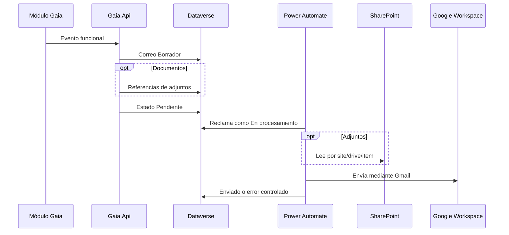

# Notificaciones institucionales por correo

> Estado: **base transversal implementada; flujo Power Automate y validación ambiental pendientes** · Verificado: **2026-10-13**
> Evidencia principal: `Gaia.BuildingBlocks.Notifications`, `DataverseEmailNotificationQueue`, `DataverseSolicitudesNotificationPublisher` y solución Dataverse `ConfiguracionCorreo`.

## Propósito

Gaia genera notificaciones desde cualquier módulo sin acoplar sus casos de uso a Gmail, Outlook o Power Automate. La API registra una intención completa e idempotente en Dataverse; Power Automate procesa únicamente correos listos y usa la cuenta institucional de Google Workspace `notificaciones@gaiaamazonas.org`.

## Modelo Dataverse

La solución `ConfiguracionCorreo` contiene:

- `gaia_plantillacorreo`: plantillas versionadas y vigentes;
- `gaia_correosaliente`: outbox con destinatarios, contenido final e idempotencia;
- `gaia_adjuntocorreo`: referencias internas a documentos de SharePoint, nunca binarios;
- opciones globales para estado, prioridad, proveedor, modo de entrega y estado del adjunto.

La clave `gaia_idoperacion` evita duplicados. La API conserva asunto y HTML renderizados para que una modificación posterior de la plantilla no cambie evidencia histórica.

## Contrato de la API

`IEmailNotificationOutbox` es el puerto transversal. Recibe módulo, evento, origen, plantilla, destinatarios, variables y referencias opcionales de SharePoint. La implementación:

1. normaliza códigos y direcciones;
2. resuelve exactamente una plantilla activa y vigente;
3. codifica como HTML los valores insertados en el cuerpo;
4. crea el correo en `Borrador`;
5. registra todos los adjuntos;
6. cambia a `Pendiente` únicamente al completar las validaciones;
7. reutiliza `gaia_idoperacion` si el mismo comando se repite.

Los errores de preparación dejan evidencia controlada y no exponen respuestas de proveedor, tokens ni direcciones temporales.

## Integración inicial de Solicitudes

Eventos conectados:

| Evento | Plantilla | Destinatario |
|---|---|---|
| Radicación | `SOLICITUD_RADICADA` | solicitante con correo institucional activo |
| Asignación o reasignación general | `SOLICITUD_ASIGNADA` | responsable específico |
| Reasignación de etapa | `SOLICITUD_ETAPA_ASIGNADA` | responsable específico de la gestión |

Una bandeja de unidad sin responsable individual no genera correo masivo: todavía no existe una regla aprobada para decidir si se notifica a todos los integrantes, a una cuenta compartida o a un rol. La operación funcional no se revierte si el correo no puede encolarse; el error queda registrado para conciliación.

## Plantillas iniciales requeridas

Las tres plantillas deben crearse como versión `1`, módulo `SOLICITUDES`, perfil `GAIA_INSTITUCIONAL`, idioma `es-CO`, sin adjuntos obligatorios y activas. Variables disponibles:

- comunes: `numeroSolicitud`, `servicio`, `asunto`, `fechaLimite`;
- radicación: además `fechaRadicacion`;
- asignación: además `responsable`;
- etapa: además `responsable` y `etapa`.

## Flujo de Power Automate pendiente

El flujo debe estar incluido en una solución y usar referencias de conexión y variables de entorno. Reglas mínimas:

1. disparador Dataverse al agregar o modificar `gaia_correosaliente`, filtrado por cambios de `gaia_estadoenvio`;
2. continuar únicamente si el estado es `Pendiente` y `gaia_disponibledesde` no está en el futuro;
3. reclamar el registro como `En procesamiento` antes de descargar archivos;
4. obtener adjuntos activos relacionados y leer SharePoint mediante sus identificadores estables;
5. enviar mediante Gmail desde `notificaciones@gaiaamazonas.org`, asociado al perfil lógico `GAIA_INSTITUCIONAL`;
6. actualizar `Enviado`, fecha e identificador devuelto por Gmail;
7. clasificar fallos temporales como `Error reintentable` y definitivos como `Error definitivo`;
8. limitar concurrencia y evitar procesar dos veces una misma fila;
9. no registrar cuerpo, destinatarios ni contenido de archivos en el historial de ejecución.

Se requiere un segundo flujo programado o una rama controlada de reintento para devolver a `Pendiente` los errores reintentables cuyo `gaia_proximointento` ya venció y que no superaron `gaia_maximointentos`.

## Seguridad y operación

- La conexión de Dataverse y la conexión Gmail pertenecen a identidades institucionales administradas.
- La autenticación OAuth de `notificaciones@gaiaamazonas.org` se conserva exclusivamente en la referencia de conexión de Power Automate; nunca en Dataverse ni en el repositorio.
- La conexión de SharePoint se restringe al sitio requerido; ningún secreto se guarda en las tablas.
- Solo la API y el flujo pueden crear o procesar correos salientes.
- Administradores funcionales pueden mantener plantillas, pero no modificar correos enviados.
- Los adjuntos respetan los límites del conector Gmail; para archivos grandes se utiliza el modo vínculo cuando la política lo permita.
- La retención y conciliación se definen antes de automatizar depuración.

## Validación antes de producción

- crear las tres plantillas iniciales;
- importar y activar los flujos con sus referencias de conexión;
- probar idempotencia, concurrencia, destinatario sin correo y plantilla ausente;
- probar envío con cero, uno y varios adjuntos de SharePoint;
- probar error temporal, reintento y error definitivo;
- confirmar que radicar o reasignar continúa funcionando cuando Power Automate está detenido;
- revisar auditoría sin datos sensibles innecesarios.
